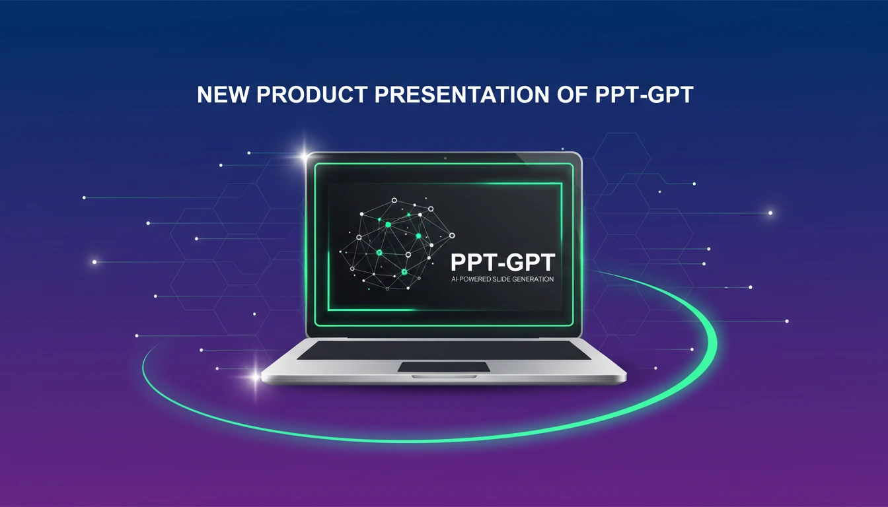
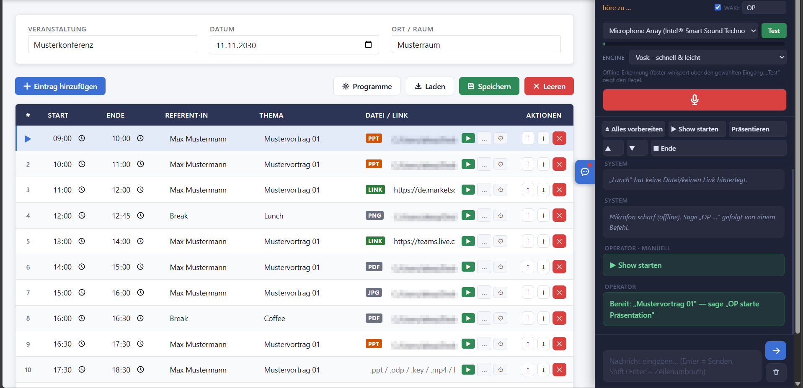

# PPT-GPT

Steuerzentrale für Konferenzen und Vortragsreihen unter Windows: Ein Zeitplan
(Timetable) mit allen Beiträgen, aus dem heraus Präsentationen, PDFs, Videos,
Bilder und Links geöffnet und gesteuert werden – per Klick oder per
Sprachbefehl. Die Spracherkennung läuft vollständig offline auf dem eigenen
Rechner.

Das Programm heißt im Fenster und als Datei **PPT Operator**.

## Funktionen

- **Timetable** mit Start, Ende, Referent·in, Thema und Datei oder Link je
  Eintrag; Sortieren per Drag & Drop, Speichern und Laden als JSON,
  automatisches Zwischenspeichern.
- **Präsentationen starten und steuern** – `.ppt`, `.pptx` und `.odp` starten
  direkt als Bildschirmpräsentation ab Folie 1: mit Microsoft PowerPoint oder,
  wenn das nicht installiert ist, mit LibreOffice bzw. Apache OpenOffice
  (Impress). PDFs laufen im Browser-Vollbild.
- **Sprachsteuerung, offline** – mit Whisper (genau) oder Vosk (schnell und
  leicht), optional mit Aktivierungswort. Beispiele: „nächste Folie",
  „zurück", „springe zu Folie 5", „starte Präsentation", „beende
  Präsentation", „Show starten", „alles vorbereiten".
- **Leinwand wählen** – jeder Eintrag kann einem Bildschirm zugewiesen werden;
  das Fenster wird dort geöffnet und auf volle Größe gezogen.
- **Vorab öffnen und vorholen** – Inhalte vor der Veranstaltung öffnen und im
  richtigen Moment nach vorne holen.
- **Laufende Fenster einbinden** – ein bereits laufendes Teams- oder
  Zoom-Meeting auf die Leinwand legen und randlos auf Vollbild ziehen; beim
  Beenden wird der ursprüngliche Zustand wiederhergestellt.
- **KI-Assistent (optional)** – lokal mit Ollama oder LM Studio, alternativ
  OpenAI, Mistral, Grok oder Claude mit eigenem API-Schlüssel.

## Installation

1. Unter [Releases](https://github.com/AlexMagerl/PPT-GPT/releases) die
   aktuelle ZIP-Datei herunterladen.
2. In einen beliebigen Ordner entpacken.
3. `Start.bat` doppelklicken. Der Browser öffnet sich mit der Oberfläche unter
   `http://localhost:3737`.

Das Konsolenfenster, das dabei aufgeht, *ist* das Programm. Zum Beenden das
Fenster schließen.

### Windows-Warnung beim ersten Start

Das Programm ist nicht digital signiert. Windows SmartScreen zeigt deshalb
„Der Computer wurde durch Windows geschützt". Über **Weitere Informationen →
Trotzdem ausführen** lässt es sich starten. Manche Virenscanner melden
Programme, die mit PyInstaller gebaut wurden, fälschlich als verdächtig.

## Systemvoraussetzungen

- Windows 10 oder 11, 64 Bit
- ein aktueller Browser, empfohlen Edge, Chrome oder Brave (für das Mikrofon)
- Microsoft PowerPoint, LibreOffice oder Apache OpenOffice, wenn
  Präsentationen gezeigt werden sollen
- etwa 250 MB Speicherplatz für das Programm, zusätzlich für die Sprachmodelle
- Internetverbindung beim ersten Einschalten des Mikrofons

## Sprachmodelle

Die Modelle sind nicht im Download enthalten. Beim ersten Einschalten des
Mikrofons fragt das Programm nach und lädt das gewählte Modell einmalig herunter:

| Modell | Größe | Hinweis |
|---|---:|---|
| Whisper „tiny" | ca. 75 MB | am schnellsten |
| Whisper „small" | ca. 490 MB | empfohlen |
| Whisper „medium" | ca. 1,5 GB | genauer, langsamer |
| Vosk (deutsch) | ca. 45 MB | schnell und leicht |

Gespeichert werden sie unter `%LOCALAPPDATA%\PPT-Operator\models`. Die
Erkennung läuft auf dem Prozessor; auf langsameren Rechnern empfiehlt sich
„tiny" oder Vosk.

## Wichtig zu wissen

- **„Ende" schließt PowerPoint, LibreOffice bzw. OpenOffice vollständig.** Damit die
  nächste Präsentation sauber startet, beendet das Programm die jeweilige
  Anwendung samt aller offenen Dateien. Andere Präsentationen vorher speichern.
- **Fernsteuerung nur vom eigenen Rechner.** Die Oberfläche ist ausschließlich
  unter `localhost` erreichbar; Anfragen fremder Webseiten werden abgewiesen.
- **Geladene Timetables werden geprüft.** Enthält eine fremde Timetable-Datei
  Verweise auf ausführbare Programme, fragt das Programm vor der Übernahme nach.
- **Port 3737** muss frei sein. Läuft das Programm schon, öffnet `Start.bat`
  nur den Browser.

## Datenschutz

Spracherkennung, Timetable und Programmsteuerung laufen vollständig lokal.
Daten verlassen den Rechner nur, wenn der KI-Assistent mit einem Cloud-Anbieter
genutzt wird – dann gehen die Chat-Nachrichten an diesen Anbieter.
Einstellungen, Timetable und API-Schlüssel speichert der Browser im lokalen
Speicher dieses Rechners, API-Schlüssel dabei unverschlüsselt.

## Deinstallation

Den entpackten Ordner löschen, dazu `%LOCALAPPDATA%\PPT-Operator` mit den
heruntergeladenen Sprachmodellen.

## Software von Dritten

Der Download enthält Bibliotheken anderer Projekte, unter anderem Python,
OpenSSL, NumPy, ONNX Runtime, CTranslate2, faster-whisper, Vosk, Tokenizers
und pywin32. Sie stehen unter ihren eigenen Lizenzen. Eine vollständige
Aufstellung mit Lizenz und Lizenztext je Komponente liegt im Ordner
`LIZENZEN` (Übersicht: `LIZENZEN/THIRD_PARTY_NOTICES.md`).
